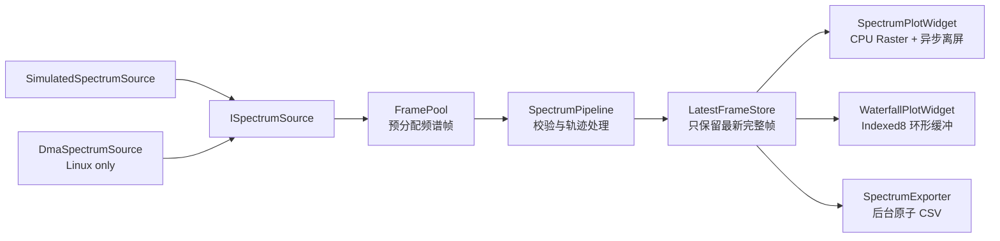

# RFSoC ZU47DR 实时频谱分析仪

这是一个运行于 RFSoC ZU47DR PS 端 Linux（以及 Windows 开发环境）的 Qt/C++ 实时频谱分析仪。PL 侧负责 DDC、FFT 和 AXI DMA 输出；PS 应用负责接收频谱帧、轨迹处理、测量、瀑布图、显示与数据导出。

当前代码同时包含模拟数据源、Linux DMA 用户态数据源、内核 DMA 驱动和 PC/板端共用的显示软件。需要区分以下成熟度：

| 状态 | 内容 |
|---|---|
| 已实现 | Qt Widgets 应用、模拟源、DMA 用户态源、Linux DMA 驱动、频谱/瀑布图显示、轨迹、Marker、CSV/PNG、JSON 场景、日志和自动测试代码 |
| PC 已验证 | Windows Qt 6 构建、20/20 CTest、离屏 GUI、模拟数据管线和 PL 行为仿真 |
| 板端待验 | PetaLinux/Qt 5.15 实际构建、ZU47DR 显示、DMA 吞吐、缓存一致性、触摸和长稳 |
| 协议/标定待确认 | RBW/PSD/每 bin 功率语义、绝对幅度标定；V1 帧头已实现 |

当前测试集为 20 项 CTest。2026-11-04 在 Windows Qt 6.10.2 Debug 构建中已完成 20/20 通过；仓库中的 2026-07-26 历史 14/14 只对应旧测试集，不能作为当前结论。

## 项目定位

- 目标平台：RFSoC ZU47DR PS 端，AArch64 Linux / PetaLinux 2023.2；
- 开发平台：Windows + Qt 6.x + C++17 + CMake；
- 源码兼容基线：Qt 6.x，并保持 Qt 5.15.x API 兼容；
- 渲染方式：CPU Raster `QPainter`，不依赖 GPU、OpenGL、Qt Quick 或 `QOpenGLWidget`；
- 数据流：数据源发布完整频谱帧，GUI 只消费最新完整帧，测量与导出使用完整频点；
- 当前默认数据源：`simulated`；Linux 设备可用时可选择 `dma`。

PL 输出协议已按 V1 接口方案实现为：64 字节版本化帧头 + 每 bin 2 字节的 `int16` 对数幅度（0.01 dB/LSB，dBFS）。DMA 用户态实现从帧头读取 bin count、span、center、trace mode、window 和 calibration offset，不再把裸 `int32` 当作幅度。当前 PL 默认输出 1024 点；65536 点和 200 MHz 级带宽仍需后续 PL 资源/时序扩展。

## 已实现功能

### 数据源与采集

- `ISpectrumSource` 统一数据源契约和 `SpectrumSourceFactory`；
- 模拟源：噪声、两个可配置固定信号、扫频、随机瞬态、故障注入和可重复随机种子；
- 限速输入与无等待压测，输入帧率范围 1～1,000 FPS；
- 开始/连续、单次、暂停/继续、停止，采集异常可隔离并重新启动；
- Linux `DmaSpectrumSource`：`open`、`mmap`、`poll`、`ioctl` 环形缓冲；
- DMA 启动前通过 `/dev/uioX` 的 `rtsa_regs` 写入 Center/Span/Calibration/Epoch；找不到 UIO 时回退到 PL 默认配置；
- 128 个 256 KiB 槽位，共 32 MiB 映射区；每轮 `poll` 最多处理 64 帧；
- 默认 DMA 配置为 1,024 bins、Center 1 GHz、Span 200 MHz、约 60 FPS UI 发布、FFT shift 关闭；
- PL 输出 64 B 帧头 + `int16` 对数幅度，PS 直接解析为 dBFS；
- 非 Linux 平台会明确报错，不会回退到模拟源。

### 频谱、瀑布图与交互

- 1,024～65,536 个频点；
- Center/Span 与 Start/Stop 双向同步，常用 Span 快捷按钮；
- Clear/Write、Average、Max Hold、Min Hold，平均次数 1～1,024；
- M1～M4、Delta、Peak/Next/Previous、峰值门限、Marker 转中心；
- 鼠标滚轮缩放、拖动平移、Shift 框选、双击复位、键盘操作和触摸 Pinch/Pan；
- 频谱、瀑布图、双视图三种显示方式，默认双视图；
- 瀑布图使用 `Format_Indexed8` 环形缓冲，历史深度 64～2,048 行，默认 512 行；
- 五种瀑布色表：Classic Rainbow、Rohde & Schwarz、Ironbow、Deep Ocean、Grayscale；
- 四种绘图区主题、自定义背景色、六种轨迹颜色和自定义颜色、1～4 px 线宽、网格开关；
- CPU Raster 异步离屏渲染、静态层 RGB16、脏区贴图和按屏幕列 min/max 包络压缩。

### 测量、文件与诊断

- 幅度单位与标定状态显示，当前模拟默认 dBFS；
- `SpectrumMeasurements` 核心类提供区间峰值和线性功率域信道功率计算；
- 当前四个 GUI 标签页未提供区间测量控件，因此不能把这些核心能力描述为现有可视化入口；
- 文件菜单提供 CSV 导出、PNG 截图、模拟场景保存和退出；
- CSV 使用点击时的不可变完整帧快照，并由 `QSaveFile` 原子提交；
- PNG 仅截取频谱控件，不包含瀑布图和右侧参数面板；
- JSON 模拟场景 v2，兼容 v1；加载和保存均执行严格校验；
- 配置格式 v4，自动保存窗口、频率、幅度、轨迹和显示设置；
- UTC 结构化滚动日志，支持级别、单文件大小和保留数量配置；
- 状态区显示输入/显示 FPS、数据率、丢帧、处理/绘制耗时、帧龄和显示延迟 P95。

## 运行架构



绘制路径将完整频点按屏幕列压缩为最小值/最大值包络，避免窄带峰因抽点消失。离屏工作线程渲染到 `QImage::Format_RGB16`，主线程 `paintEvent()` 只把脏区贴到窗口；离屏结果不可用时退回同步 Raster 绘制。

实际源码目录：

```text
src/
  app/         程序入口与命令行
  core/        帧、帧池、频率映射、轨迹、测量、包络和数据管线
  sources/     模拟源、DMA 源、场景加载/保存和数据源工厂
  plot/        频谱绘制、瀑布图和色表
  services/    配置、日志、CSV 导出
  ui/          主窗口、主题和频率输入控件
tests/         20 项 Qt Test / CTest
driver/DMA/    Linux dmaengine 驱动、UAPI 和设备树示例
config/        模拟场景
```

## Windows 构建与运行

### 依赖

- Qt 6.x：Core、Gui、Widgets、Concurrent、Test；
- CMake 3.21 或更高；
- Ninja；
- 支持 C++17 的 MinGW-w64 或 MSVC。

以下命令使用通用路径占位符，请替换为本机 Qt/编译器路径：

```powershell
cmake -S . -B build\win-qt6-release -G Ninja `
  -DCMAKE_BUILD_TYPE=Release `
  -DCMAKE_PREFIX_PATH="<Qt6>/<toolchain>"

cmake --build build\win-qt6-release --parallel
ctest --test-dir build\win-qt6-release --output-on-failure
cmake --install build\win-qt6-release --prefix build\install
```

Windows 安装时 `RTSA_DEPLOY_WINDOWS_RUNTIME` 默认开启，会调用 `windeployqt` 部署 Qt DLL、编译器运行库和 platform plugin。运行时必须保留完整安装目录，不能只复制 `rtsa_app.exe`。

常用启动方式：

```powershell
build\win-qt6-release\src\rtsa_app.exe --source simulated
build\win-qt6-release\src\rtsa_app.exe --source simulated --fullscreen
build\win-qt6-release\src\rtsa_app.exe --source simulated `
  --scenario config\default-simulation.json
build\win-qt6-release\src\rtsa_app.exe --source simulated `
  --scenario config\unthrottled-stress.json --smoke-test-ms 3000
build\win-qt6-release\src\rtsa_app.exe --log-level info `
  --log-dir logs --log-max-bytes 5242880 --log-retained-files 3
```

`--smoke-test-ms` 会自动开始采集并在指定时间后正常退出，且不读写用户配置。完整参数见 `rtsa_app --help` 和[用户说明](docs/development/实时频谱分析仪上位机功能介绍与使用说明.md)。

### 主要命令行参数

| 参数 | 说明 |
|---|---|
| `--source simulated\|dma` | 选择数据源，默认 `simulated` |
| `--scenario <path>` | 加载模拟场景；仅允许搭配模拟源 |
| `--fullscreen` | 全屏启动 |
| `--smoke-test-ms <ms>` | 自动采集后退出，适合冒烟测试 |
| `--log-dir <path>` | 指定日志目录 |
| `--log-level debug\|info\|warning\|error` | 设置最低日志级别 |
| `--log-max-bytes <bytes>` | 单文件最小 1,024 字节 |
| `--log-retained-files <1-10>` | 保留轮转文件数量 |
| `--no-file-log` | 关闭文件日志，仅用于测试/诊断 |

退出码：`2` 日志参数错误，`3` 未知数据源，`4` 数据源创建失败，`5` DMA 与场景参数冲突，`6` 场景读取失败。

## Linux / PetaLinux 构建

PetaLinux 版本号不能证明 rootfs 已安装对应 Qt。应在目标 SDK 中检查 Qt 版本、Widgets、字体、PNG 插件和所选 QPA 插件：

```sh
qmake -query QT_VERSION
source <SDK-environment-setup>

cmake -S . -B build/petalinux-aarch64 -G Ninja \
  -DCMAKE_BUILD_TYPE=Release \
  -DCMAKE_TOOLCHAIN_FILE="$OECORE_NATIVE_SYSROOT/usr/share/cmake/OEToolchainConfig.cmake" \
  -DRTSA_BUILD_TESTS=OFF \
  -DRTSA_TARGET_PETALINUX=ON

cmake --build build/petalinux-aarch64 --parallel
cmake --install build/petalinux-aarch64 --prefix "$PWD/stage"
```

`RTSA_TARGET_PETALINUX=ON` 会启用严格的 PetaLinux/AArch64 目标检查。实际 SDK 环境脚本和 sysroot 路径由工程配置决定。

板端无 GPU 时可尝试：

```sh
export QT_QPA_PLATFORM=linuxfb
export QT_QPA_FB_HIDECURSOR=1
./rtsa_app --source simulated --fullscreen
```

真实 DMA 还需要加载内核模块并准备对应设备节点。驱动的构建、DTS 和联调步骤见 [DMA 驱动解析](docs/development/DMA驱动解析.md) 与 [DMA 接入方案](docs/design/ZU47DR_PL_AXIDMA频谱数据接入差距分析与后续实施方案.md)。

## CMake 选项

| 选项 | 默认值 | 说明 |
|---|---:|---|
| `RTSA_BUILD_TESTS` | `ON` | 构建测试；SDK 不含 Qt Test 时设为 `OFF` |
| `RTSA_ENABLE_WARNINGS_AS_ERRORS` | `OFF` | 将编译警告视为错误 |
| `RTSA_TARGET_PETALINUX` | `OFF` | 启用严格 PetaLinux/AArch64 检查 |
| `RTSA_DEPLOY_WINDOWS_RUNTIME` | `ON` | Windows 安装时运行 `windeployqt` |

项目当前没有 `RTSA_ENABLE_DMA_SOURCE` 选项；DMA 源在 Linux 构建中直接参与编译。

## 测试

当前 `tests/CMakeLists.txt` 注册 20 项测试：

| 测试 | 覆盖重点 |
|---|---|
| `rtsa_core_tests` | 频率映射、包络、轨迹、帧池、幅度单位、区间测量核心和遥测 |
| `rtsa_source_tests` | 模拟源、暂停/恢复、故障、抽象接口和快速停止 |
| `rtsa_plot_tests` | 无 OpenGL 离屏 Raster、Marker、交互和外观配置 |
| `rtsa_export_tests` | CSV 内容、单位/标定元数据和失败时无残缺文件 |
| `rtsa_settings_tests` | 默认值、v4 往返、旧版本迁移和损坏回退 |
| `rtsa_logging_tests` | 级别过滤、字段清洗、轮转、并发和 Qt 消息桥接 |
| `rtsa_scenario_tests` | 场景 v1/v2 加载、保存、范围/类型/大小校验 |
| `rtsa_waterfall_tests` | Indexed8 环形缓冲、历史深度、色表、交互和渲染 |
| `rtsa_frame_codec_tests` | 64 B 帧头、int16 对数载荷、FFT shift、包络、UIO 配置映射和管线 |
| `rtsa_gui_tests` | 主窗口、频率同步、轨迹、Marker、单次采集和数据源注入 |
| `rtsa_app_smoke` | 应用离屏启动、采集和正常退出 |
| `rtsa_app_render_direct_smoke` | Direct 渲染模式启动与退出 |
| `rtsa_app_render_benchmark_static_smoke` | Static 合成基准启动与退出 |
| `rtsa_app_render_benchmark_mixed_smoke` | Mixed 合成基准启动与退出 |
| `rtsa_app_scenario_smoke` | 默认场景离屏启动 |
| `rtsa_app_fault_scenario_smoke` | 故障注入场景启动与退出 |
| `rtsa_app_invalid_source` | 无效数据源退出码 |
| `rtsa_app_scenario_source_mismatch` | DMA 与场景冲突退出码 |
| `rtsa_app_missing_scenario` | 场景读取失败退出码 |
| `rtsa_app_invalid_render_benchmark` | 非法渲染基准模式退出码 |

历史报告中的性能数据来自 2026-07-26 的 Windows Qt 6 Release 环境，例如 16,384 点请求 1,000 FPS、1920×1080 主窗口等。性能结论只在当时平台和测试条件下成立，不能直接外推到 ZU47DR。详细记录见[项目实现与验证报告](docs/development/项目实现与验证报告.md)。

## CSV、配置与日志

CSV 先写元数据注释和动态单位表头，再写每个频点：

```text
# RTSA spectrum snapshot
# sequence=...
# timestamp_ns=...
# center_frequency_hz=...
# span_hz=...
# bin_count=...
# amplitude_unit=dbfs
# calibrated=false
bin,frequency_hz,amplitude_dbfs
0,900000000.000000,-110.123456
```

配置通过 `QSettings` 保存：Windows 使用 Qt 原生设置存储，Linux 通常为 `~/.config/RTSA/RTSA.conf`。当前格式为 v4，兼容旧版本；未知版本、损坏值或越界值会整体回退到安全默认值。

仓库提供三个场景：

- `config/default-simulation.json`：默认演示；
- `config/unthrottled-stress.json`：16,384 点无等待压测；
- `config/fault-injection.json`：暂停、序号跳变、异常帧和突发故障。

场景格式为 v2，兼容 v1；文件上限 1 MiB，最多两个固定信号。

日志默认位于 Qt 应用本地数据目录下的 `logs`，文件名 `rtsa.log`，历史文件为 `rtsa.log.1` 等。记录采用 UTC 时间、级别、模块、事件和原因字段，并转义换行及字段分隔符。

## 当前边界

- 真实 DMA 路径已有用户态实现和驱动，但尚无 ZU47DR 板端吞吐、缓存一致性、延迟和长稳证据；
- V1 帧头已实现，但当前 PL 仍固定 1024 点；默认 span 9.765625 MHz，`CIC=1/HB=0` 的旁路模式可到 312.5 MHz，精确 200 MHz 和更大 FFT 点数尚未落地；
- PS→PL 的 UIO 寄存器控制层已接入启动前和运行中 staging + commit：软参数帧边界生效，DDS/CIC/HB 由 PL 内部重配，DMA 不停机；迹线模式和 4096/16384/65536 点仍待实现；
- 每 bin 是功率还是 PSD、RBW/ENBW 和绝对幅度标定尚未冻结；
- 区间峰值/信道功率只有核心实现和测试，当前 GUI 没有对应控件；
- PetaLinux/Qt 5.15 交叉编译和 linuxfb/X11/Wayland 显示仍需在目标 rootfs 验证；
- Windows 模拟性能结果不能替代板端性能结果；
- PNG 不包含瀑布图和参数面板，CSV 也不保存瀑布历史。

## 文档索引

文档已按用途分为三类，入口见 [docs/README.md](docs/README.md)：

- **设计方案**：[需求、总体架构、PL/PS 接口、DMA 协议、带宽规划](docs/design/)
- **开发文档**：[构建、板端联调、驱动、测试、实现报告、用户说明](docs/development/)
- **学习资料**：[历史对话、优化记录、专题讲解](docs/learning/)（可能包含过期内容，不作为当前规范）
