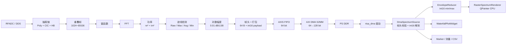
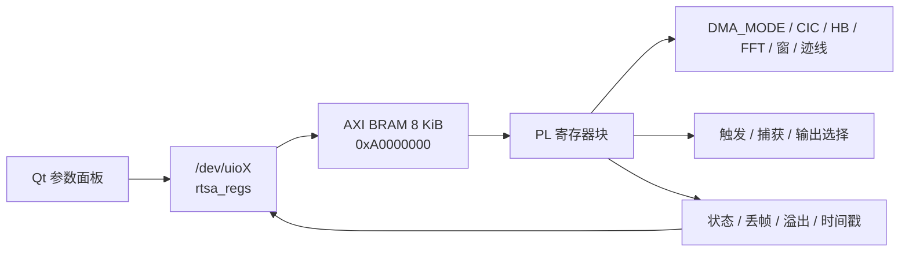

# RFSoC ZU47DR 实时频谱分析仪
## PL-PS 频谱数据接口与实现方案（V1.0）

| 项目 | 内容 |
|---|---|
| 文档版本 | V1.0 |
| 日期 | 2026-11-04 |
| 适用平台 | XCZU47DR-FFVE1156-2-I / PetaLinux / Qt 5.15+ |
| 适用范围 | PL RTL、Linux DMA 驱动、PS Qt 上位机 |
| 目标 | 大带宽、实时频谱分析、PS 无 GPU 绘制 |
| 状态 | 设计基线；V1 已实现，板端待验收 |

---

## 0. 文档目的

本文档定义 PL 与 PS 之间**唯一的频谱数据契约**，并给出 PL、驱动、PS 三端的落地实现方案。

设计初期存在以下接口错位（**均已在当前 V1 实现中解决，保留作为背景**）：

- PL 输出 64 位复数 FFT bin，PS 仍按 32 位幅度解析；
- PL 每帧 8 KiB，PS 只拷贝 4 KiB；
- PL 默认 span 为 9.765625 MHz，PS 默认按 200 MHz 显示；
- PS 没有 PL 寄存器控制入口，RFADC、触发、捕获无法使用；
- 驱动曾按 256 KiB 固定槽位提交 DMA，和当前帧长不一致；现已改为 132 KiB + `frame_size`。

本文档不再兼容这些旧假设。**PL、PS、驱动均可修改，以本文档为准。**

> 2026-11-06 当前状态：V1 帧头、int16 对数幅度、132 KiB 槽、UIO staging+commit、运行中 DMA 不停机和 312.5 MHz CIC 旁路均已实现。本文后续章节保留设计推导；具体当前实现状态见 [开发文档](../development/README.md)。

---

## 1. 设计目标与原则

### 1.1 主要指标

1. 支持大带宽输入和 1024～65536 点 FFT；
2. 支持实时频谱刷新，目标 30 FPS 底线、60 FPS 目标；
3. PS 端无 GPU，最终频谱由 Qt `QPainter` CPU 光栅绘制；
4. PS 每帧工作量尽量与频点数解耦，只与屏幕宽度相关；
5. 频谱、瀑布图、Marker、峰值搜索、信道功率、CSV 使用同一套数据语义；
6. 接口可扩展到更高带宽、更多频点和未来测量功能。

### 1.2 设计原则

| 原则 | 说明 |
|---|---|
| PL 做重运算 | FFT、功率、迹线检测、取对数全部在 PL 完成 |
| PS 只做显示准备 | 包络压缩、坐标映射、QPainter 绘制 |
| 对数幅度上总线 | 频谱显示天然是对数，不在 PS 端逐 bin 做 `sqrt/log10` |
| 16 位对数 | 0.01 dB/LSB，2 B/bin，动态范围约 655 dB |
| 全频点传输 | PL 不做屏幕列压缩，Marker/测量仍使用完整频点 |
| 每帧独立帧头 | 元数据与帧绑定，不使用“读寄存器猜当前帧”的方式 |
| 一帧一个 DMA packet | `TLAST` 明确帧边界，驱动和 PS 易校验 |
| 实际值回传 | 帧头携带实际 span、bin count、sample rate，不使用 PS 猜测值 |
| IQ 独立通道 | 相位/时域 IQ 不进入频谱显示流 |

---

## 2. 最终方案摘要

### 2.1 频谱流

| 项目 | 方案 |
|---|---|
| 每 bin 格式 | `int16_t` 有符号对数幅度 |
| 单位 | dBFS |
| 量化 | 0.01 dB/LSB |
| 每 bin 字节 | 2 B |
| 频点数 | 1024 / 4096 / 16384 / 65536 |
| 帧头 | 64 B 版本化帧头 |
| 字节序 | 小端 |
| 帧边界 | `TLAST` 在 payload 最后一个 beat |
| 1024 点帧长 | 2112 B |
| 65536 点帧长 | 131136 B |
| DMA 槽位建议 | 132 KiB |
| 默认迹线 | PL Max Hold，可配置 Raw/Average/Min Hold |
| PS 显示 | `int16` 包络压缩 + CPU Raster |

### 2.2 IQ 捕获流

| 项目 | 方案 |
|---|---|
| 数据格式 | 16 位或 32 位复数 I/Q |
| 采样点数 | 最大 8192 |
| 帧头 | 独立 64 B IQ 帧头 |
| 用途 | 触发前后时域 IQ、相位分析、调试 |
| 与频谱流关系 | 通过 `dma_output_select` 切换，不混流 |

### 2.3 关键数字

```text
频谱 payload 字节数 = bin_count × 2
频谱帧字节数       = 64 + bin_count × 2

1024 点   = 64 + 2048   = 2112 B
4096 点   = 64 + 8192   = 8256 B
16384 点  = 64 + 32768  = 32832 B
65536 点  = 64 + 131072 = 131136 B
```

---

## 3. 系统架构

### 3.1 数据流



### 3.2 控制流



### 3.3 职责边界

| 模块 | 负责 | 不负责 |
|---|---|---|
| PL | 采样、抽取、FFT、功率、迹线、对数、帧头、DMA 打包 | 屏幕坐标、Marker、UI |
| 驱动 | DMA 搬运、槽位管理、完成时间戳、`info.size` | 解析频谱 payload |
| PS | 帧头解析、包络压缩、绘制、Marker、测量、CSV | 逐 bin FFT、逐 bin log、逐 bin 平均 |

---

## 4. 频谱数据格式

### 4.1 为什么选择对数幅度

频谱仪的显示纵轴本质上是对数幅度。把对数运算放在 PL 有四个好处：

1. PS 不需要对 65536 个 bin 逐点做 `sqrt` 和 `log10`；
2. 16 位对数可以覆盖约 655 dB，远大于 16 位线性的约 96 dB；
3. 16 位数据量只有 32 位的一半，降低 DDR 和 cache 压力；
4. Marker、峰值搜索、瀑布色表都可以直接在 `int16` 上比较和映射。

### 4.2 16 位对数编码

```text
value = round(dBFS × 100)
dBFS  = value × 0.01
```

| 项目 | 值 |
|---|---|
| 类型 | `int16_t` |
| 单位 | dBFS |
| LSB | 0.01 dB |
| 表示范围 | -327.68 ～ +327.67 dB |
| 实际钳位 | -200.0 ～ +20.0 dBFS |
| 字节序 | little-endian |

示例：

| dBFS | int16 值 |
|---:|---:|
| 0.00 | 0 |
| -10.00 | -1000 |
| -100.00 | -10000 |
| -120.00 | -12000 |
| +10.00 | 1000 |

### 4.3 dBFS 参考定义

本文档规定：

> **0 dBFS = ADC 输入端满量程正弦波，经过当前窗函数和 FFT scaling 归一化后，在对应 bin 上得到的幅度。**

PL 负责：

1. 补偿 FFT scaling schedule；
2. 补偿窗函数相干增益；
3. 输出以 dBFS 为单位的对数幅度。

PS 负责：

1. 加 `calibration_offset_db_q16_16` 得到 dBm；
2. 如需要，再叠加频率相关校准表。

> V1/P2 实现说明：当前 PL 输出原始 `10log10(power)`，PS 在 `binDb()` 中加帧头
> `calibration_offset_db`（默认 -190 dB）得到 dBFS；这个偏移当前承担“满量程参考”
> 的作用，不等同于 RF dBm 标定。后续绝对 dBm 标定应作为独立偏移/频率表叠加。

窗函数相干增益示例：

| 窗 | 相干增益 | 幅度补偿 |
|---|---:|---:|
| Rectangular | 1.000 | 0.0 dB |
| Hann | 0.500 | +6.0 dB |
| Hamming | 0.540 | +5.35 dB |
| Blackman | 0.420 | +7.53 dB |
| Blackman-Harris 4-term | 约 0.358 | 约 +8.9 dB |

最终以窗函数表为准，PL 和 PS 共用同一张表。

### 4.4 32 位对数扩展格式

如果未来需要计量级精度，可启用 `data_format=1`：

```text
int32_t value = round(dBFS × 65536)
dBFS = value / 65536.0
```

- Q16.16，1 LSB ≈ 0.000015 dB；
- 每 bin 4 B；
- 65536 点帧长 262208 B，槽位需要 264 KiB；
- 不作为 V1 默认格式。

### 4.5 字节序、对齐与 TLAST

- 所有多字节字段使用 **little-endian**；
- 帧头 64 B，8 字节对齐；
- payload 从帧头后立即开始；
- `frame_bytes` 必须是 8 的倍数；
- `TKEEP = 0xFF`，不使用部分字节；
- `TLAST` 在 payload 最后一个 64-bit beat 拉高；
- 一帧一个 AXI4-Stream packet。

### 4.6 频点顺序与 FFT shift

V1 建议：

- PL 输出 FFT 自然顺序 `0..N-1`；
- `flags.fft_shift = 0`；
- PS 显示时映射为 DC 居中的顺序：

```text
display_bin[i] = source_bin[(i + N/2) % N]
```

- Marker、峰值搜索、信道功率使用同一映射；
- 触发 bin 范围使用自然顺序，PS/PL 配置时单独说明。

如果后续 PL 改为 DC 居中输出，则设置 `flags.fft_shift = 1`，PS 不再做映射。

### 4.7 迹线模式与累积语义

| `trace_mode` | 含义 | PL 行为 | PS 行为 |
|---:|---|---|---|
| 0 | Raw | 输出最近的 FFT 帧，可按 `accumulation_frames` 做时间抽帧 | 可自行做 Max/Average |
| 1 | Max Hold | 对 `accumulation_frames` 帧逐 bin 取最大功率 | 直接显示，不再重复 Max Hold |
| 2 | Average | 对 `accumulation_frames` 帧逐 bin 功率求平均 | 直接显示，不再重复 Average |
| 3 | Min Hold | 对 `accumulation_frames` 帧逐 bin 取最小功率 | 直接显示 |

注意：

- Average 必须在**线性功率域**做，不能对 dB 值直接平均；
- Max Hold / Min Hold 可以直接比较功率，也可以在 dB 域比较，结果等价；
- 配置变化（FFT 点数、窗、span、center、抽取、增益）必须在帧边界复位迹线历史；
- 帧头 `trace_mode` 和 `accumulation_frames` 必须与当前输出一致。

### 4.8 RBW / ENBW 定义

复数 FFT：

```text
RBW = span_hz / bin_count
ENBW = RBW × K_window
```

实 FFT：

```text
RBW = (span_hz / 2) / bin_count
```

V1 使用复数 FFT，PS 用 `span_hz / bin_count` 计算 RBW。

典型窗函数 ENBW 系数：

| 窗 | ENBW 系数 |
|---|---:|
| Rectangular | 1.00 |
| Hann | 1.50 |
| Hamming | 1.36 |
| Blackman | 1.73 |
| Blackman-Harris 4-term | 约 1.90 |
| Flat-top | 约 3.77 |

最终以窗函数表为准。

### 4.9 时间戳与序号

- `sequence`：PL 每输出一帧频谱递增，uint64，PS 用于检测丢帧；
- `timestamp_ticks`：PL 312.5 MHz 自由计数，uint64；
- `timestamp_ns = timestamp_ticks × 3.2`；
- 驱动完成中断时再记录 `ktime_get_ns()`，用于计算 DMA/IRQ 延迟；
- `timestamp_ticks` 建议取“产生该迹线的最近一帧 FFT 的第一个时域样本时刻”。

---

## 5. 帧格式

### 5.1 64 字节帧头

| 偏移 | 字节 | 字段 | 类型 | 说明 |
|---:|---:|---|---|---|
| 0x00 | 4 | `magic` | uint32 | `0x52545341`，ASCII "RTSA" |
| 0x04 | 2 | `version` | uint16 | V1 = 1 |
| 0x06 | 2 | `header_bytes` | uint16 | 固定 64 |
| 0x08 | 4 | `frame_bytes` | uint32 | 帧头 + payload |
| 0x0C | 4 | `flags` | uint32 | 见 5.2 |
| 0x10 | 8 | `sequence` | uint64 | PL 帧序号 |
| 0x18 | 8 | `timestamp_ticks` | uint64 | 312.5 MHz 计数 |
| 0x20 | 8 | `center_freq_hz` | int64 | RF 中心频率 |
| 0x28 | 8 | `span_hz` | uint64 | 实际 FFT span |
| 0x30 | 4 | `bin_count` | uint32 | 1024/4096/16384/65536 |
| 0x34 | 1 | `trace_mode` | uint8 | 0=Raw，1=Max，2=Avg，3=Min |
| 0x35 | 2 | `accumulation_frames` | uint16 | 累积帧数 |
| 0x37 | 1 | `window_type` | uint8 | 窗函数枚举 |
| 0x38 | 4 | `calibration_offset_db_q16_16` | int32 | 原始 log→dBFS 偏移；后续 RF 标定单独叠加 |
| 0x3C | 1 | `data_format` | uint8 | 0=int16 log 0.01 dB |
| 0x3D | 1 | `unit` | uint8 | 0=dBFS，1=dBm，2=dBc |
| 0x3E | 2 | `config_epoch` | uint16 | 配置提交计数 |

总计 64 B。

### 5.2 flags

| 位 | 名称 | 说明 |
|---:|---|---|
| 0 | `LOG_FORMAT` | 1=对数格式 |
| 1 | `COMPLEX` | 1=复数 IQ，频谱流为 0 |
| 2 | `CALIBRATED` | 1=已应用校准 |
| 3 | `FFT_SHIFT` | 1=DC 居中 |
| 4 | `TRIGGER_FRAME` | 1=触发相关帧 |
| 5 | `IQ_CAPTURE` | 1=IQ 捕获帧 |
| 6 | `OVERRANGE` | 1=ADC over-range |
| 7 | `FIFO_OVERFLOW` | 1=PL FIFO 溢出 |
| 8 | `FRAME_VALID` | 1=正常帧 |
| 9～31 | 保留 | 必须写 0 |

### 5.3 data_format

| 值 | 格式 | 每 bin 字节 |
|---:|---|---:|
| 0 | int16 对数 dBFS，0.01 dB/LSB | 2 |
| 1 | int32 对数 dBFS，Q16.16 | 4 |
| 2 | int32 线性功率 + 块指数（可选扩展） | 4 |
| 3 | int16 复数 IQ | 4/采样点 |
| 4 | int32 复数 IQ | 8/采样点 |
| 5～255 | 保留 | - |

### 5.4 unit

| 值 | 单位 |
|---:|---|
| 0 | dBFS |
| 1 | dBm |
| 2 | dBc |
| 3 | linear |
| 4 | raw counts |

### 5.5 window_type

| 值 | 窗 |
|---:|---|
| 0 | Rectangular |
| 1 | Hann |
| 2 | Hamming |
| 3 | Blackman |
| 4 | Blackman-Harris 4-term |
| 5 | Flat-top |
| 6 | Kaiser |
| 7～255 | 保留 |

### 5.6 payload

`data_format=0`：

```text
payload[k] = int16_t(dBFS[k] × 100)
```

- 小端；
- 2 B/bin；
- 全频点；
- 不包含屏幕列压缩。

### 5.7 帧长

| bin_count | payload | header | frame_bytes | 64-bit beats |
|---:|---:|---:|---:|---:|
| 1024 | 2048 | 64 | 2112 | 264 |
| 4096 | 8192 | 64 | 8256 | 1032 |
| 16384 | 32768 | 64 | 32832 | 4104 |
| 65536 | 131072 | 64 | 131136 | 16392 |

### 5.8 校验与错误处理

PS 必须校验：

1. `magic == 0x52545341`；
2. `version == 1`；
3. `header_bytes == 64`；
4. `frame_bytes == 64 + bin_count × bytes_per_bin`；
5. `bin_count` 在支持范围内；
6. `data_format` 已知；
7. `info.size >= frame_bytes`；
8. `sequence` 连续或明确丢帧；
9. `config_epoch` 与当前配置一致。

任一失败：

- 丢弃该帧；
- 增加错误计数；
- 记录一次有限频率日志；
- 不把部分数据送入绘制管线。

### 5.9 示例帧

1024 点、16 位对数、Max Hold 80 帧：

```text
magic          = 0x52545341
version        = 1
header_bytes   = 64
frame_bytes    = 2112
flags          = LOG_FORMAT | FRAME_VALID
bin_count      = 1024
trace_mode     = 1
accum_frames   = 80
window_type    = 4
data_format    = 0
unit           = 0
config_epoch   = 7
payload        = 1024 × int16
```

---

## 6. PS → PL 寄存器与控制接口

### 6.1 UIO 映射

- PL 寄存器位于 `axi_bram_ctrl_0`，基地址 `0xA0000000`，大小 8 KiB；
- Linux 设备树：

```dts
&axi_bram_ctrl_0 {
    compatible = "generic-uio";
    linux,uio-name = "rtsa_regs";
    status = "okay";
};
```

- PS 通过 `/dev/uioX` 打开，`mmap` 8192 B，offset 0；
- 使用 32 位小端访问；
- 通过 `/sys/class/uio/uio*/name` 查找 `rtsa_regs`，不要写死 `uio0`。

### 6.2 寄存器表

| 偏移 | 名称 | 读/写 | 说明 |
|---:|---|---|---|
| 0x000 | `ID` | R | `0x52545341` |
| 0x004 | `CONTROL` | RW | 使能/复位/commit/输出选择/触发 |
| 0x008 | `DMA_MODE` | RW | 1=DDS，2=ADC0，3=ADC1 |
| 0x00C | `CIC_RATE` | RW | 1=旁路；4～8192 正常抽取 |
| 0x010 | `CIC_TRUNC` | RW | 0～80 |
| 0x014 | `HB_LEVEL` | RW | 0～6 |
| 0x018 | `FFT_SIZE` | RW | 1024/4096/16384/65536 |
| 0x01C | `WINDOW_TYPE` | RW | 窗函数枚举 |
| 0x020 | `TRACE_MODE` | RW | 0～3 |
| 0x024 | `ACCUM_FRAMES` | RW | 1～65535 |
| 0x028 | `CENTER_LOW` | RW | `center_freq_hz[31:0]` |
| 0x02C | `CENTER_HIGH` | RW | `center_freq_hz[63:32]` |
| 0x030 | `SPAN_REQ_LOW` | RW | 请求 span 低 32 位 |
| 0x034 | `SPAN_REQ_HIGH` | RW | 请求 span 高 32 位 |
| 0x038 | `CAL_OFFSET` | RW | Q16.16 dB |
| 0x03C | `TRIG_START_BIN` | RW | 10 位 |
| 0x040 | `TRIG_END_BIN` | RW | 10 位 |
| 0x044 | `TRIG_THRESH_LOW` | RW | 64 位功率门限低 32 位 |
| 0x048 | `TRIG_THRESH_HIGH` | RW | 64 位功率门限高 32 位 |
| 0x04C | `PRE_SAMPLES` | RW | 0～8192 |
| 0x050 | `POST_SAMPLES` | RW | 0～8192 |
| 0x054 | `CONFIG_EPOCH` | RW | 写入后 commit 使用 |
| 0x058 | `STATUS` | R | 见 6.3 |
| 0x05C | `TRIG_BIN` | R | 触发 bin |
| 0x060 | `FRAME_SEQ_LOW` | R | PL 帧序号低 32 位 |
| 0x064 | `FRAME_SEQ_HIGH` | R | PL 帧序号高 32 位 |
| 0x068 | `FRAME_DROP_COUNT` | R | PL 丢帧计数 |
| 0x06C | `FIFO_OVERFLOW_COUNT` | R | PL FIFO 溢出计数 |
| 0x070 | `RFDC_MISMATCH_COUNT` | R | RFADC I/Q valid 不一致计数 |
| 0x074 | `ACTUAL_SPAN_LOW` | R | 实际 span 低 32 位 |
| 0x078 | `ACTUAL_SPAN_HIGH` | R | 实际 span 高 32 位 |
| 0x07C | `ACTUAL_SAMPLE_RATE` | R | 实际采样率 Hz |
| 0x080 | `PL_TIMESTAMP_LOW` | R | 时间戳低 32 位 |
| 0x084 | `PL_TIMESTAMP_HIGH` | R | 时间戳高 32 位 |
| 0x088 | `CONFIG_EPOCH_ACTIVE` | R | 当前生效 epoch |
| 0x08C | `ERROR_STATUS` | R | 错误位 |
| 0x090 | `SCRATCH` | RW | 测试寄存器 |

### 6.3 CONTROL 与 STATUS

`CONTROL`：

| 位 | 名称 | 说明 |
|---:|---|---|
| 0 | `ENABLE` | 1=频谱引擎使能 |
| 1 | `SOFT_RESET` | 1=软复位，自清零 |
| 2 | `COMMIT` | 1=提交配置，自清零 |
| 3 | `DMA_OUTPUT_SELECT` | 0=频谱，1=IQ |
| 4 | `TRIGGER_ENABLE` | 触发使能 |
| 5 | `CAPTURE_ARM_TOGGLE` | 写 1 翻转捕获 arm |
| 6 | `TRIGGER_CLEAR_TOGGLE` | 写 1 翻转触发清除 |
| 7 | `BYPASS_CIC_HB` | 1=旁路 CIC/HB，用于大带宽 |
| 8～31 | 保留 | 0 |

`STATUS`：

| 位 | 名称 |
|---:|---|
| 0 | `CIC_BUSY` |
| 1 | `TRIGGER_LATCHED` |
| 2 | `CAPTURE_READY` |
| 3 | `CAPTURE_BUSY` |
| 4 | `CAPTURE_TRIGGERED` |
| 5 | `CAPTURE_DONE` |
| 6 | `CONFIG_BUSY` |
| 7 | `FRAME_VALID` |
| 8 | `FIFO_OVERFLOW` |
| 9 | `FRAME_DROP` |
| 10 | `RFDC_MISMATCH` |
| 11 | `DMA_BACKPRESSURE` |

`ERROR_STATUS`：

| 位 | 名称 |
|---:|---|
| 0 | `HEADER_ERROR` |
| 1 | `CONFIG_ERROR` |
| 2 | `FRAME_DROP` |
| 3 | `FIFO_OVERFLOW` |
| 4 | `RFDC_MISMATCH` |
| 5 | `CAPTURE_ERROR` |
| 6 | `DMA_OVERFLOW` |

### 6.4 配置提交与帧边界

1. PS 写入 `DMA_MODE/CIC/HB/FFT_SIZE/WINDOW/TRACE/ACCUM/CENTER/SPAN/CAL`；
2. PS 写 `CONTROL.COMMIT=1`；
3. PL 在**下一帧起始边界**锁存配置；
4. `CONFIG_EPOCH_ACTIVE` 递增；
5. 新帧头使用新的 `config_epoch`；
6. PS 读到新 epoch 后才认为配置生效。

要求：

- 不允许在帧中途改变 FFT 点数、窗、抽取值；
- 若配置非法（CIC 越界、FFT 不支持、span 不可达），PL 置 `CONFIG_ERROR`，保持旧配置；
- PS 在配置期间可以继续显示旧帧，但必须标记“配置未生效”。

### 6.5 64 位字段写入顺序

对于 `CENTER/SPAN/THRESHOLD`：

1. 写 low 32 位；
2. 写 high 32 位；
3. 写 `COMMIT`。

读取时：

1. 读 high；
2. 读 low；
3. 再读 high；
4. 若两次 high 不同，重读。

---

## 7. PL 实现方案

### 7.1 现有链路与改动

当前链路：

```text
dec_module
  -> overlap_fft_module
       -> frame_ctrl_v3
       -> window_rom
       -> xfft_1024
       -> fft_max_hold
  -> trigger_module
  -> DMA mux
```

目标链路：

```text
dec_module
  -> overlap_frame_ctrl (可变 1024~65536)
  -> window_rom (按点数选择)
  -> fft_wrapper (1024~65536)
  -> power_trace_detector (Raw/Max/Avg/Min)
  -> log_magnitude (输出时取对数)
  -> spectrum_frame_builder (64 B header + int16 pack + TLAST)
  -> axis_data_fifo
  -> AXI DMA S2MM
```

### 7.2 数据源与抽取

保留：

- `active_signal` 内部 DDS；
- RFADC Tile0/Tile1 选择；
- Poly 4:1；
- CIC 可编程 4～8192；`CIC=1` 为旁路宽带模式；
- HB 0～6。

新增：

- `BYPASS_CIC_HB` 旁路，用于 200 MHz 以上大带宽；
- 实际采样率计算：

```text
rfdc_rate = 5 GSPS / 4 = 1.25 GSPS
poly_rate = rfdc_rate / 4 = 312.5 MSPS
final_rate = poly_rate / (cic_rate × 2^hb_level)
```

- 实际 span：

```text
span_hz = final_rate   // 复数 FFT
```

- `ACTUAL_SAMPLE_RATE` 和 `ACTUAL_SPAN` 由 PL 计算，写入寄存器和帧头。

大带宽建议：

- 目标 200 MHz 以上时，旁路 CIC/HB；
- Poly 输出 312.5 MSPS；
- 65536 点 FFT 的 span 为 312.5 MHz，RBW 约 4.77 kHz；
- PS 可缩放到 200 MHz 显示。

### 7.3 重叠帧与窗

- `frame_width_reg` 支持 1024/4096/16384/65536；
- `overlap_ratio_reg` 建议 75%；
- hop = frame_width - overlap；
- 帧 RAM 深度按最大 65536 设计；
- 窗 ROM：
  - 1024/4096/16384 可分别建表；
  - 65536 建议 65536 × 18 bit BRAM 表，约 144 KiB；
  - 或使用分段 LUT + 插值，降低 BRAM。

### 7.4 FFT

- 使用 Xilinx FFT IP，`pipelined_streaming_io`；
- 输入 32 bit，输出 32 bit；
- `scaled` + `truncation`；
- 支持 1024/4096/16384/65536；
- 每个点数使用独立 wrapper 或参数化 wrapper；
- 65536 点需要单独做资源和时序评估；
- FFT 输出自然顺序，`flags.fft_shift=0`。

### 7.5 功率与迹线检测

每个 bin：

```text
real = signed(fft_tdata[31:0])
imag = signed(fft_tdata[63:32])
power = real*real + imag*imag
```

迹线检测：

| 模式 | 存储 | 更新 |
|---|---|---|
| Raw | 最近一帧功率 | 覆盖 |
| Max Hold | 每 bin 最大功率 | `if power > stored: stored = power` |
| Average | 每 bin 功率累加 + 帧计数 | 输出时除以 N |
| Min Hold | 每 bin 最小功率 | `if power < stored: stored = power` |

要求：

- 在功率域比较/累加；
- 配置变化时清空历史；
- 输出帧率由 `accumulation_frames` 控制；
- 65536 点时，迹线存储约 512 KiB（64-bit power）；
- 读写带宽需要 2～4 个 BRAM bank 或 ping-pong，避免单端口瓶颈。

### 7.6 对数与量化

对数模块只在**输出迹线**上运行，不对每个 FFT 帧逐 bin 运行：

```text
db = 10*log10(power / full_scale_power) + window_correction_db
value = clamp(round(db * 100), -32768, 32767)
```

实现建议：

- 先算 `log2(power)`，再乘 `10*log10(2) ≈ 3.0103`；
- 使用 leading-one + LUT + 线性插值；
- 流水线 4～8 级；
- 输出 `int16`；
- 65536 点 × 60 fps = 3.9M log/s，一个 312.5 MHz log 核足够。

### 7.7 帧头、打包与 TLAST

新增 `spectrum_frame_builder`：

1. 帧开始时锁存 header 字段；
2. 先发送 8 个 64-bit header beat；
3. 每个 64-bit beat 打包 4 个 `int16` bin（64 / 16 = 4）；
4. `TLAST` 在最后一个 payload beat；
5. `TKEEP=0xFF`；
6. 背压时保持 `TVALID/TDATA/TLAST` 稳定；
7. 输出 `sequence` 和 `timestamp_ticks`。

帧头字段来源：

- `center_freq_hz`：寄存器；
- `span_hz`：PL 计算的实际值；
- `bin_count`：寄存器；
- `trace_mode`/`accumulation_frames`：寄存器；
- `window_type`：寄存器；
- `calibration_offset_db`：寄存器；
- `config_epoch`：配置提交计数；
- `sequence`：PL 帧计数器；
- `timestamp_ticks`：312.5 MHz 计数器。

### 7.8 FIFO、DMA 与背压

- `axis_data_fifo` 建议 8192 × 64 bit = 64 KiB；
- `prog_full` 阈值按最大帧 burst 设置，建议 4096；
- FFT 输入 FIFO 深度 8192/16384，阈值 4096；
- 帧准入：
  - 新帧开始时检查 FIFO 是否有足够余量；
  - 不足则丢弃整帧并计数；
  - 不允许半帧写入；
- 最终 FIFO 溢出计数映射到 `FIFO_OVERFLOW_COUNT`；
- `FRAME_DROP_COUNT` 映射到寄存器；
- DMA 背压时，PL 不能覆盖未发送帧。

### 7.9 寄存器与状态

重写 `axi_bram_ctrl`/`reg_ctrl`：

- 实现第 6 节寄存器表；
- `COMMIT` 在帧边界锁存；
- `CONFIG_EPOCH` 递增；
- 状态/计数器可读；
- UIO 8 KiB 映射；
- 所有跨时钟域信号做 2 级同步。

### 7.10 时钟、复位与 CDC

- `r_clk = 312.5 MHz`：FFT、迹线、log、帧头；
- `axi_bram_clk = 100 MHz`：PS 寄存器；
- `axis_data_fifo` 异步 312.5 MHz → 100 MHz；
- 配置信号从 100 MHz 到 312.5 MHz 使用 2 级同步 + `COMMIT` 脉冲；
- 状态/计数器从 312.5 MHz 到 100 MHz 使用 2 级同步或握手；
- 软复位必须同时复位 FFT、迹线、帧控制器、帧头计数器。

### 7.11 资源与带宽预算

65536 点粗估：

| 资源 | 估算 |
|---|---|
| FFT IP | 约 300～500 RAMB36，200～300 DSP |
| 帧 RAM 65536×64 | 约 114 RAMB36 |
| 窗 ROM 65536×18 | 约 32 RAMB36 |
| 迹线 65536×64 | 约 114 RAMB36 |
| 其他 FIFO/ILA | 约 50～100 RAMB36 |
| 合计 | 约 600～850 RAMB36 |
| 器件可用 | 1080 RAMB36 |

结论：资源可行但余量不大，必须用 Vivado 实现报告确认。

迹线带宽：

```text
65536 bin × 8 B × 4.77k FFT/s ≈ 2.5 GB/s（单读或单写）
```

Max Hold 需要读+写，约 5 GB/s；建议 2 个 BRAM bank 或 128-bit 宽端口。

### 7.12 分阶段实现

| 阶段 | 内容 | 验证 |
|---|---|---|
| P1 | 1024 点，16 位 log，64 B header，TLAST | DDS 单音、PS 解析 |
| P2 | 4096/16384 点，UIO 配置，Trace 模式 | 频率/幅度/帧头 |
| P3 | 65536 点，旁路 CIC/HB，312.5 MSPS | 资源/时序/带宽 |
| P4 | 触发/IQ 捕获，校准，长稳 | 板端验收 |

### 7.13 仿真计划

新增/修改 testbench：

1. `tb_spectrum_frame_builder`：64 B header、int16 pack、TLAST、背压；
2. `tb_log_magnitude`：已知功率→dB 值，误差 < 0.01 dB；
3. `tb_trace_detector`：Max/Avg/Min/Raw；
4. `tb_fft_wrapper_65536`：帧边界、TLAST、吞吐；
5. `tb_regs_uio`：commit、epoch、状态；
6. `tb_backpressure`：FIFO 满、丢帧、溢出计数；
7. `tb_cdc_config`：100 MHz→312.5 MHz 配置同步。

---

## 8. PS 实现方案

### 8.1 数据结构

```cpp
struct SpectrumFrame {
    FrameMetadata metadata;
    std::vector<int16_t> bins;   // dBFS × 100
};
```

`FrameMetadata` 建议包含：

```cpp
uint64_t sequence;
uint64_t timestampTicks;
uint64_t centerFrequencyHz;
uint64_t spanHz;
uint32_t binCount;
uint16_t accumulationFrames;
uint16_t configEpoch;
uint8_t  traceMode;
uint8_t  windowType;
uint8_t  dataFormat;
uint8_t  unit;
bool     fftShift;
bool     calibrated;
double   rbwHz;
double   enbwHz;
double   calibrationOffsetDb;
```

### 8.2 DmaSpectrumSource

流程：

1. `open("/dev/rtsa_dma")`；
2. `mmap` 槽位空间；
3. `RTSA_IOC_SET_FRAME_SIZE` 设置 `frame_bytes`；
4. `RTSA_IOC_START`；
5. `poll` + `DEQUEUE`；
6. 从 slot 起始读 64 B header；
7. 校验 header；
8. 按 `data_format=0` 解析 `int16` payload；
9. 填 `SpectrumFrame`；
10. `RTSA_IOC_QUEUE` 归还槽位；
11. 按 UI 刷新率投递最新帧。

错误处理：

- `magic/version/header_bytes/frame_bytes/bin_count` 错误：丢帧计数；
- `info.size < frame_bytes`：短包计数；
- 未知 `data_format`：拒绝；
- `sequence` 跳变：丢帧计数；
- 连续错误：上报 UI 状态栏。

### 8.3 SpectrumPipeline

- DMA 模式设 `traceAlreadyDetected = true`；
- `trace_mode != 0` 时跳过 PS 的 Average/Max Hold；
- `trace_mode == 0` 时 PS 可做 Max Hold/Min Hold；
- 配置 epoch 变化时清空轨迹历史；
- 不把 PL 已平均的数据再次平均。

### 8.4 包络压缩与绘制

`EnvelopeReducer`：

```cpp
struct EnvelopeColumn {
    int16_t minValue;
    int16_t maxValue;
};
```

- 输入 `const int16_t* bins`；
- 每个屏幕列取 min/max；
- 输出长度 = 绘图区宽度；
- 不做浮点转换；
- `RasterSpectrumRenderer` 只在列级把 `int16` 转成 `dB` 和像素坐标。

绘制：

- `dB = value * 0.01 + calibrationOffsetDb`；
- y 轴映射；
- 静态层、RGB16、离屏线程、脏区贴图保持不变；
- Marker/网格/文字只在列级绘制。

### 8.5 瀑布图

- `WaterfallPlotWidget` 直接消费 `int16` 对数 bin；
- `Colormap::mapToColorIndex(dB)` 映射；
- 历史仍用 `Format_Indexed8`；
- 不需要逐 bin 浮点转换。

### 8.6 Marker、测量与 CSV

- Marker/Peak Search：在 `int16` 上比较；
- 频率映射：

```text
freq = center - span/2 + (bin + 0.5) * span / binCount
```

- `fft_shift=1` 时直接映射；`fft_shift=0` 时先做 `(bin + N/2) % N`；
- 信道功率：

```text
P = Σ 10^(dBFS_i / 10)
P_dBm = P_dBFS + calibration_offset_db
```

- CSV：`dB = value * 0.01`；
- OBW：在 dB 域找累计功率边界，内部按线性功率累加。

### 8.7 UI 行为

DMA 模式下：

- FFT 点数、CIC、HB、窗、Trace 模式、积累帧数由硬件配置面板控制；
- span/center 显示帧头实际值；
- 显示 `RBW/ENBW`；
- 显示 PL `FRAME_DROP_COUNT/FIFO_OVERFLOW_COUNT/RFDC_MISMATCH_COUNT`；
- Trace 模式为 PL Average/Max 时，禁用 PS 对应重复处理；
- 配置未生效时显示提示；
- 实际 span 与请求 span 不一致时显示警告。

### 8.8 性能预算

65536 点、60 fps：

| 项目 | 数量 |
|---|---:|
| 每帧 int16 数据 | 128 KiB |
| 每帧包络比较 | 65536 次 |
| 每秒包络比较 | 3.93M 次 |
| 每帧列级浮点转换 | ≤ 1920 次 |
| 每秒 QPainter 图元 | ≤ 115k |

结论：

- 数据准备不再是瓶颈；
- QPainter 绘制仍是主瓶颈；
- 继续使用离屏线程、RGB16 静态层、脏区贴图；
- 最终 FPS 必须板端实测。

### 8.9 PS 测试

1. 帧头解析 golden frame；
2. `int16` → dBFS 转换；
3. 小端字段；
4. 1024/65536 点；
5. 短包/长包/错误 magic；
6. `int16` 包络 min/max；
7. Marker/Peak 频率；
8. 信道功率/OBW；
9. 瀑布色表；
10. CSV 输出；
11. 渲染性能回归。

---

## 9. 驱动实现方案

### 9.1 UAPI

```c
#define RTSA_RING_BUFFER_COUNT   128
#define RTSA_SLOT_SIZE           (132 * 1024)
#define RTSA_MAX_FRAME_SIZE      (131136)

struct rtsa_buffer_info {
    __u32 index;
    __u32 size;
    __u64 sequence;
    __u64 timestamp_ns;
    __u32 status;
    __u32 reserved;
};

#define RTSA_IOC_SET_FRAME_SIZE  _IOW('R', 5, __u32)
#define RTSA_IOC_GET_STATS       _IOR('R', 6, struct rtsa_stats)
```

### 9.2 DMA 传输

- 一帧一个 `dmaengine_prep_slave_single`；
- 长度 = `frame_bytes`；
- `TLAST` 结束 packet；
- 驱动不解析 payload；
- 完成回调记录 `info.size` 和 `timestamp_ns`；
- 失败时归还槽位并计数。

### 9.3 槽位与队列

- 128 个槽位 × 132 KiB ≈ 16.5 MiB；
- 完成队列 128 项；
- 溢出时重新提交槽位；
- 用户态未及时消费时计数；
- `RTSA_IOC_SET_FRAME_SIZE` 只在停止状态允许修改。

### 9.4 时间戳

- `timestamp_ns` = DMA 完成中断时间；
- PL 时间戳在帧头；
- PS 可计算：

```text
latency = completion_time - pl_timestamp_ns
```

### 9.5 mmap 与 CMA

- 一次 `dma_alloc_coherent` 分配 128 × 132 KiB；
- `mmap` 整块映射；
- 设备树 CMA 保持 128 MiB；
- 保证 64 位 DMA mask。

### 9.6 设备树

```dts
&axi_bram_ctrl_0 {
    compatible = "generic-uio";
    linux,uio-name = "rtsa_regs";
    status = "okay";
};

&amba_pl {
    rtsa_dma_node {
        compatible = "rtsa,spectrum-dma";
        dmas = <&axi_dma_0 0>;
        dma-names = "rx_chan";
        status = "okay";
    };
};
```

### 9.7 驱动错误处理

- `info.size` 小于 `frame_bytes`：短包；
- DMA residue 异常：使用固定 `frame_bytes` + 帧头校验；
- 队列溢出：计数并重新提交；
- 设备关闭/模块卸载：停止通道、释放内存；
- UAPI 增加版本号，避免 ABI 漂移。

### 9.8 驱动测试

- `dma_benchmark` 按 131136 B/帧测试；
- 60 fps、200 fps、1000 fps；
- 短包/错误注入；
- 长稳 24 h；
- 溢出计数；
- 多进程/单进程排他打开。

---

## 10. IQ 捕获流

### 10.1 触发与捕获

- 频率模板触发使用原始 FFT 功率；
- 捕获 RAM 8192 × 64 bit；
- pre/post 可配置；
- `capture_arm` 翻转触发；
- `capture_done` 后通过 DMA 输出；
- `CONTROL.DMA_OUTPUT_SELECT=1` 切换到 IQ；
- 切换必须在帧边界。

### 10.2 IQ 帧头

| 偏移 | 字节 | 字段 |
|---:|---:|---|
| 0x00 | 4 | `magic` |
| 0x04 | 2 | `version` |
| 0x06 | 2 | `header_bytes` |
| 0x08 | 4 | `frame_bytes` |
| 0x0C | 4 | `flags` |
| 0x10 | 8 | `sequence` |
| 0x18 | 8 | `timestamp_ticks` |
| 0x20 | 8 | `center_freq_hz` |
| 0x28 | 8 | `sample_rate_hz` |
| 0x30 | 4 | `sample_count` |
| 0x34 | 4 | `trigger_bin` |
| 0x38 | 8 | `trigger_timestamp_ticks` |
| 0x40 | 4 | `pre_samples` |
| 0x44 | 4 | `post_samples` |
| 0x48 | 1 | `data_format` |
| 0x49 | 1 | `unit` |
| 0x4A | 2 | `config_epoch` |
| 0x4C | 4 | 保留 |
| 0x50 | 4 | 保留 |
| 0x54 | 4 | 保留 |
| 0x58 | 4 | 保留 |
| 0x5C | 4 | 保留 |

总计 64 B。

### 10.3 IQ payload

- `data_format=3`：`int16 I` + `int16 Q`，4 B/sample；
- `data_format=4`：`int32 I` + `int32 Q`，8 B/sample；
- `TLAST` 在最后一个 sample；
- 8192 sample × 8 B = 64 KiB，132 KiB 槽位可容纳。

### 10.4 PS IQ 解析

- 独立的 `IqCaptureFrame`；
- 时域图、频谱、相位；
- 不与频谱 `SpectrumFrame` 混用；
- CSV/二进制导出单独实现。

---

## 11. 大带宽与实时预算

### 11.1 采样率与抽取

当前链路：

```text
RFADC 5 GSPS / 4 = 1.25 GSPS
Poly 4:1 = 312.5 MSPS
CIC 8 × HB 4 = 9.765625 MSPS
```

大带宽建议：

```text
RFADC 5 GSPS / 4 = 1.25 GSPS
Poly 4:1 = 312.5 MSPS
BYPASS CIC/HB = 312.5 MSPS
```

结论：

- 正常 CIC 路径最小抽取 4，会把最大采样率限制到 78.125 MSPS；
- 当前实现已增加 `CIC_RATE=1` 旁路模式，可把 FFT 输入提高到 312.5 MSPS；
- 要精确覆盖 200 MHz 或继续提高带宽，需要改 RFDC/多相抽取组合，或做并行样点处理；
- 接口格式不依赖具体采样率，帧头回传实际值。

### 11.2 帧长与数据率

16 位对数、Max Hold 80 帧、60 fps 输出：

| bin_count | 采样率 | FFT 帧率 | frame_bytes | 原始 FFT 数据率 | 80 帧累积后 | 60 fps 输出 |
|---:|---:|---:|---:|---:|---:|---:|
| 1024 | 9.765625 MSPS | 38.15k/s | 2112 | 80.6 MB/s | 1.0 MB/s | 0.127 MB/s |
| 1024 | 312.5 MSPS | 305.18k/s | 2112 | 644.5 MB/s | 8.06 MB/s | 0.127 MB/s |
| 4096 | 78.125 MSPS | 19.07k/s | 8256 | 157.5 MB/s | 1.97 MB/s | 0.50 MB/s |
| 16384 | 156.25 MSPS | 9.54k/s | 32832 | 313 MB/s | 3.9 MB/s | 1.97 MB/s |
| 65536 | 312.5 MSPS | 4.77k/s | 131136 | 625 MB/s | 7.8 MB/s | 7.87 MB/s |

说明：

- 原始 FFT 数据率是 PL 内部迹线检测的带宽需求；
- DMA 只发送累积后的帧；
- 65536 点的迹线存储带宽是主要挑战；
- 如果 PL 不做迹线累积，只做时间抽帧，则 PL 资源降低，但会漏掉帧间峰值。

### 11.3 PL 内存带宽

65536 点 Max Hold：

```text
每 bin 读旧值 + 写新值 = 16 B
65536 × 16 B × 4.77k ≈ 5 GB/s
```

建议：

- 2 个 BRAM bank 或 128-bit 宽端口；
- 或把迹线存储降到 32-bit 功率 + 块指数；
- 或使用 Raw + 时间抽帧，避免逐帧累积。

### 11.4 PS CPU 与绘制

- 65536 点 int16 包络：3.93M 次比较/s；
- 列级浮点：≤ 115k 次/s；
- QPainter：≤ 115k 图元/s；
- 数据准备不是瓶颈，绘制是瓶颈；
- 继续使用离屏线程、RGB16 静态层、脏区贴图。

### 11.5 延迟预算

65536 点、312.5 MSPS：

| 环节 | 估算 |
|---|---:|
| FFT 延迟 | 65536 / 312.5 MHz ≈ 210 µs |
| 80 帧累积 | 80 / 4.77k ≈ 16.8 ms |
| DMA/IRQ | 1～2 ms |
| PS 解析/包络 | 1～3 ms |
| QPainter | 10～30 ms |
| 合计 | 约 30～50 ms |

### 11.6 65536 点可行性

必须单独验证：

1. FFT 65536 在 312.5 MHz 的时序；
2. BRAM/DSP 资源；
3. 迹线存储带宽；
4. 窗 ROM 资源；
5. 帧 RAM 资源；
6. 功耗/温度；
7. PS 绘制 FPS。

如果资源不足，降级顺序：

1. 65536 → 32768；
2. Max Hold 80 → 20；
3. Raw + 时间抽帧；
4. 降低采样率/span。

---

## 12. 校准与测量

### 12.1 dBFS 与 dBm

```text
dBm = dBFS + rf_calibration_offset_db
```

- `rf_calibration_offset_db` 包含 RF 前端增益、衰减器、线损、天线增益；帧头 `calibration_offset_db` 当前用于把 PL 原始 log 映射到 dBFS，两者在后续版本中分离；
- 频率相关校准由 PS 查表；
- 帧头只带一个粗偏移，PS 可叠加精细表。

### 12.2 窗与 FFT scaling

- PL 负责窗相干增益补偿；
- PL 负责 FFT scaling 补偿；
- PS 只加 RF 校准；
- 帧头 `window_type` 用于显示和 ENBW 计算。

### 12.3 信道功率

```text
P_linear = Σ 10^(dBFS_i / 10)
P_dBFS = 10 * log10(P_linear)
P_dBm = P_dBFS + calibration_offset_db
```

- 只对选中区间计算；
- 噪声功率按 ENBW/RBW 修正；
- 信号功率直接求和。

### 12.4 Marker 与峰值

- 在 `int16` 上找最大值；
- 可选抛物线插值提高频率精度；
- 频率映射使用帧头 center/span/bin_count；
- `fft_shift` 决定是否做 `(bin+N/2)%N` 映射。

### 12.5 Max Hold / Average

- Max Hold：功率域最大；
- Average：功率域平均；
- Min Hold：功率域最小；
- PL 已检测的迹线，PS 不重复平均；
- 配置变化时清空历史。

---

## 13. 验证与验收

### 13.1 PL 仿真

- 帧头字段/字节序；
- int16 打包/TLAST/TKEEP；
- 背压下 `TVALID/TDATA/TLAST` 稳定；
- log 精度 < 0.01 dB；
- Max/Avg/Min/Raw；
- 1024/4096/16384/65536；
- 配置 commit/epoch；
- CDC；
- FIFO 溢出/丢帧计数。

### 13.2 PS 单元/集成

- 帧头 golden frame；
- 小端字段；
- 短包/长包/错误 magic；
- 1024/65536；
- `int16` 包络；
- Marker/Peak；
- 信道功率/OBW；
- 瀑布/CSV；
- 渲染性能。

### 13.3 板端测试

1. 内部 DDS 单音：
   - 9.765625 MSPS/1024 点：1.5 MHz → bin 157；
   - 312.5 MSPS/65536 点：1.5 MHz → bin 315；
2. RFADC 输入；
3. 200 MHz/65536 点；
4. Max Hold/Average；
5. 触发/IQ 捕获；
6. 60 fps 显示；
7. 24 h 长稳；
8. 丢帧/溢出计数；
9. 校准源幅度/频率误差。

### 13.4 验收标准

| 项目 | 目标 |
|---|---|
| 帧头错误 | 0 |
| 正常运行丢帧 | 0 |
| FIFO 溢出 | 0 |
| 频率误差 | ≤ 1 bin |
| 幅度误差 | ≤ ±0.5 dB（校准后） |
| 显示延迟 | ≤ 50 ms |
| 显示 FPS | ≥ 30 FPS，目标 60 FPS |
| 24 h 内存增长 | 无可观测泄漏 |
| 24 h 死锁/崩溃 | 0 |

### 13.5 测试矩阵

| 维度 | 取值 |
|---|---|
| FFT 点数 | 1024/4096/16384/65536 |
| 采样率 | 9.765625/78.125/156.25/312.5 MSPS |
| Trace | Raw/Max/Avg/Min |
| 累积帧数 | 1/20/80/200 |
| 视图 | 频谱/瀑布/双视图 |
| 窗口 | 1920×1080/2560×1440 |
| 渲染 | Direct/Offscreen |
| 显示上限 | 30/60/100 FPS |

---

## 14. 迁移计划

### 14.1 阶段

| 阶段 | 工作 | 产出 |
|---|---|---|
| P0 | 冻结本文档，建分支，备份 PL 工程 | 接口基线 |
| P1 | PL 1024 点 16 位 log + 64 B header；PS 解析/int16 渲染；驱动 132 KiB | DDS 单音闭环 |
| P2 | UIO 配置、Trace 模式、4096/16384 | 参数化闭环 |
| P3 | 65536/312.5 MSPS、旁路 CIC/HB | 大带宽闭环 |
| P4 | 触发/IQ、校准、长稳 | 板端验收 |

### 14.2 文件改动清单

PL：

- `DMA_2026_1012.srcs/sources_1/new/spectrum_engine.v`
- `frame_ctrl_v3.v`
- `window_rom.v`
- `xfft_1024.v` → 参数化 FFT wrapper
- `fft_max_hold.v` → `power_trace_detector`
- `logic_top.v`
- `axi_bram_ctrl.v`
- `reg_ctrl.v`
- 新增 `log_magnitude.v`
- 新增 `spectrum_frame_builder.v`
- `DMA_TOP.xdc`
- `AXI_DMA.bd`

PS：

- `src/core/SpectrumFrame.h`
- `src/sources/DmaSpectrumSource.cpp/.h`
- `src/core/SpectrumPipeline.cpp/.h`
- `src/core/TraceProcessor.cpp/.h`
- `src/core/EnvelopeReducer.cpp/.h`
- `src/plot/RasterSpectrumRenderer.cpp/.h`
- `src/plot/WaterfallPlotWidget.cpp/.h`
- `src/core/SpectrumMeasurements.cpp/.h`
- `src/ui/MainWindow.cpp/.h`
- `src/services/ConfigurationStore.cpp/.h`
- `tests/`

驱动：

- `driver/DMA/rtsa_dma_uapi.h`
- `driver/DMA/rtsa_dma_driver.c`
- `driver/DMA/system-user.dtsi`
- `driver/DMA/dma_benchmark.c`

### 14.3 回滚策略

- 保留旧 `data_format=3/4` 分支；
- PS 通过帧头 `data_format` 自动选择解析器；
- 旧 PL 64 位复数格式可临时映射为 `data_format=4`；
- 新格式默认 `data_format=0`；
- 任一阶段失败可回退到上一版 bitstream + 旧解析器。

---

## 15. 风险与待决策

| 风险 | 影响 | 应对 |
|---|---|---|
| 65536 FFT 资源/时序 | 可能无法 312.5 MHz 收敛 | 先做 16384，再评估 65536 |
| 迹线存储带宽 | Max Hold 可能成为瓶颈 | 2 bank/ping-pong；或 Raw+抽帧 |
| log 核精度 | 幅度误差 | 仿真 + 标准源校准 |
| PS QPainter 60 FPS | 显示不达标 | 继续 RGB16/离屏/脏区优化 |
| DMA 长帧 | 132 KiB/帧，延迟/队列 | 128 槽位、及时归还 |
| UIO 编号 | 设备名不稳定 | 用 `linux,uio-name` 查找 |
| DSP 驱动 residue | `info.size` 不可靠 | 固定 frame_bytes + 帧头校验 |
| 端序/对齐 | 解析错位 | golden frame 测试 |
| PL 工程未纳入 Git | 版本丢失 | 只提交 RTL/BD/XDC/COE/XSA |
| 200 MHz 指标 | 当前抽取链限制 | 旁路 CIC/HB 或重设计 |

待决策：

1. V1 是否只做 16 位 log，32 位 log 放 V2；
2. 65536 点是否必须 312.5 MSPS，还是先做 156.25 MSPS；
3. Max Hold 默认 80 帧是否合适；
4. IQ 捕获用 16 位还是 32 位；
5. 校准数据来源和格式；
6. 是否把 PL 工程源文件纳入 Git。

---

## 16. 附录

### A. 帧头字节布局

```text
0x00  magic[4]       "RTSA"
0x04  version[2]
0x06  header_bytes[2]
0x08  frame_bytes[4]
0x0C  flags[4]
0x10  sequence[8]
0x18  timestamp_ticks[8]
0x20  center_freq_hz[8]
0x28  span_hz[8]
0x30  bin_count[4]
0x34  trace_mode[1]
0x35  accumulation_frames[2]
0x37  window_type[1]
0x38  calibration_offset_db_q16_16[4]
0x3C  data_format[1]
0x3D  unit[1]
0x3E  config_epoch[2]
```

### B. 关键公式

```text
frame_bytes = 64 + bin_count * bytes_per_bin
dBFS = int16_value * 0.01
dBm = dBFS + calibration_offset_db
RBW = span_hz / bin_count
ENBW = RBW * K_window
P_linear = 10^(dBFS / 10)
P_sum = Σ P_linear
P_dBFS = 10 * log10(P_sum)
timestamp_ns = timestamp_ticks * 3.2
```

### C. 帧长/数据率

见 11.2。

### D. 术语

| 术语 | 含义 |
|---|---|
| bin | 一个 FFT 频点 |
| RBW | 分辨率带宽 |
| ENBW | 等效噪声带宽 |
| Max Hold | 逐 bin 最大保持 |
| Average | 逐 bin 功率平均 |
| TLAST | AXI4-Stream 帧尾 |
| UIO | Linux Userspace I/O |
| DBFS | 相对满量程 dB |

---

## 17. 结论

V1 的最终接口是：

> **PL 输出 16 位有符号对数幅度，0.01 dB/LSB，dBFS，2 B/bin，全频点；每帧带 64 字节版本化帧头；小端；TLAST 帧尾；一帧一个 DMA packet；IQ 捕获走独立通道。**

PS 端只做：

1. 帧头校验；
2. `int16` 包络压缩；
3. 列级 dB/像素映射；
4. QPainter 绘制；
5. Marker/测量/CSV 按需计算。

这套方案把逐 bin 的 FFT、功率、迹线、对数全部放在 PL，把 PS 的工作量压缩到屏幕宽度量级，是面向“大带宽 + 实时 + 无 GPU”的最合理基线。

---

## 18. P1/P2 实施状态（2026-11-05）

已落地：

- PL 新增 `log_magnitude.v`：复数功率 → `int16` 对数幅度（0.01 dB/LSB）；
- PL 新增 `spectrum_frame_builder.v`：64 B 帧头 + 1024×`int16` payload + `TLAST`；
- `logic_top.v` 已将频谱路径接入格式化器，触发/IQ 路径保持不变；
- PL 独立仿真 `tb_spectrum_frame_builder.v`：header、payload、TLAST 通过；
- PL 完整链路仿真 `tb_logic_top_modified`：2026-11-05 PASS，221.78 µs，覆盖默认寄存器、抽取、75% 重叠帧、Max Hold、频率触发、时域捕获和 DMA 输出；
- PS 新增 `SpectrumFrameCodec`：64 B 帧头解析、int16 payload、FFT shift；
- PS `SpectrumFrame` 增加 `logBins` 与 int16 包络路径；
- `DmaSpectrumSource` 改为按帧头解析，不再按裸 int32 幅度解析；
- PS 新增 `PlRegisterMap`，通过 `/dev/uioX` 的 `rtsa_regs` 映射写入 center/span/trace/accum/window/cal/epoch；
- DMA 源启动前将当前配置写入 PL，PL 在帧边界锁存并写入帧头；
- Renderer、Waterfall、Measurements、CSV 已改用 `binDb()` 统一访问；
- 驱动 UAPI 增加 `RTSA_SLOT_SIZE=132 KiB`、`RTSA_IOC_SET_FRAME_SIZE`、`RTSA_IOC_GET_STATS`；
- 当前 Windows Debug 构建 20/20 CTest 通过。

P2 已落地的 UIO 配置路径：

- PL 寄存器 `0x100..0x120`：center、span、trace/accum、window、calibration、epoch、commit；
- `reg_ctrl` 将 PS staging 寄存器与 committed 快照分离；`0x120` commit 时原子快照，再同步到 `logic_clk`；
- `pl_config_latch` 等当前频谱帧完整输出后在帧边界锁存 active 配置；软参数只换帧头，DDS 参数额外 resync，硬参数只复位 PL 数据通路并重配 CIC；
- 运行中配置全程不执行 DMA STOP/START，不重新分配描述符环；`/dev/rtsa_dma` 和 DMA 线程持续运行；
- `spectrum_frame_builder` 在帧起始锁存 active 配置，帧头使用锁存值，避免帧中途变化；
- PS `PlRegisterMap` 支持 `/dev/uioX` 映射和测试内存映射；
- `DmaSpectrumSource` 在启动前和运行中都用同一套 staging + commit 事务下发配置；Linux 下用 `eventfd` 唤醒 DMA 线程，避免 20 ms poll 延迟；
- 旧 epoch 帧由 PS 过滤，1 秒未收到新 epoch 时告警并临时接受当前帧，避免界面永久黑屏；
- 独立仿真 `tb_reg_config`、`tb_config_latch`、`tb_config_pipeline`、`tb_spectrum_frame_builder` PASS。

注意：`tb_logic_top_modified` 的 221.78 µs PASS 对应 P1 数据路径；P2 解耦控制链由 `tb_config_pipeline` 覆盖。完整 `logic_top` 数据通路在 P2 解耦后仍需在板端或长时仿真中复验。

P2 实际 PL 寄存器地址（与 `PlRegisterMap.h` 一致）：

| 偏移 | 字段 |
|---:|---|
| 0x100 | center_freq_hz[31:0] |
| 0x104 | center_freq_hz[63:32] |
| 0x108 | span_hz[31:0] |
| 0x10C | span_hz[63:32] |
| 0x110 | trace_mode[7:0] + accumulation_frames[23:8] |
| 0x114 | window_type[7:0] |
| 0x118 | calibration_offset_q16_16 |
| 0x11C | config_epoch[15:0] |
| 0x120 | commit（写 1 翻转提交） |
| 0x130 | CONFIG_BUSY（只读，bit0） |
| 0x134 | ACTIVE_EPOCH[15:0]（只读） |

`0x200..0x224` 的 DDS/CIC/HB/Max Hold 寄存器作为 staging；其中 `0x208 DDS_RESYNC` 和 `0x21C CIC_VALID` 已改为 PL 内部产生，PS 写入无效。`0x228..0x23C` 触发寄存器保持原有即时语义。

`0x20C CIC_RATE` 的特殊值：

- `1`：CIC 旁路。多相滤波器输出直接送入 HB，HB 仍按 `2^HB_LEVEL` 抽取；`CIC=1/HB=0` 时 FFT 输入为 `312.5 MSPS`，复数 FFT span 为 `312.5 MHz`。
- `4..8192`：正常 CIC 抽取。默认 `8`，HB `2` 时 span 为 `9.765625 MHz`。
- 宽带直通模式使用 `overlap_ratio=0`（0% 重叠），避免 312.5 MSPS 满速输入时帧控制器读不完一帧；窄带模式保持 `768` 点重叠。

仍待完成：

- 板端验证运行中软/DDS/硬参数切换时 DMA 不中断、帧不撕裂、`CONFIG_BUSY/ACTIVE_EPOCH` 正确；
- 312.5 MHz 宽带模式的板端 FFT/DMA 长稳、ADC 满幅和幅度校准；
- PL 迹线模式真正支持 Raw/Average/Min Hold（当前硬件仍固定 Max Hold 80，帧头字段只是配置通道）；
- 4096/16384/65536 点 FFT、312.5 MSPS 大带宽链路与资源/时序评估；
- 触发/IQ 新格式的 PS UI；
- 绝对幅度校准、RBW/ENBW 验收和板端长稳。
